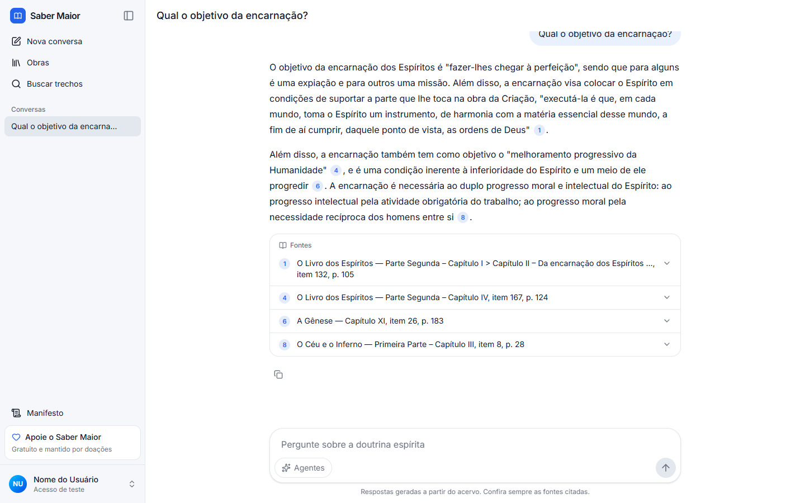
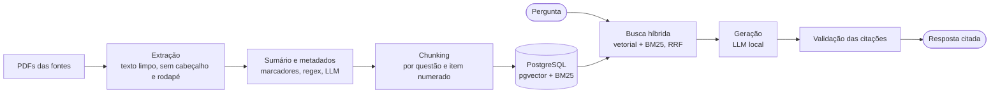

<div align="center">

<picture>
  <source media="(prefers-color-scheme: dark)" srcset="images/brand/logo-saber-maior-dark.svg">
  
</picture>

**Um buscador amigável de referências na literatura espírita, gratuito e em aberto.**

Um assistente que responde perguntas a partir das obras espíritas e mostra, em cada frase,
o trecho, a obra, o capítulo e a página de onde tirou o que diz.

[](LICENSE)


[O que é](#o-que-é) · [Fontes](#fontes) · [Como funciona](#como-funciona) · [Qualidade](#qualidade-medida) · [Roteiro](#roteiro) · [**Participe**](#participe)

</div>

<p align="center">
  
</p>

## O que é

O Saber Maior é um assistente de estudo da literatura espírita. Você faz uma pergunta em linguagem
natural, ele busca as passagens mais relevantes num acervo de centenas de obras e escreve uma
resposta em que **cada afirmação aponta para o trecho que a sustenta**. Um clique abre o texto
original, com obra, capítulo, item e página.

Princípios (versão completa no [Manifesto](https://github.com/arcade-metrics/sabermaior/blob/main/web/src/componentes/Manifesto.tsx), também publicado na interface):

- **Toda resposta mostra de onde veio.** Citações são validadas depois da geração: se o modelo
  aponta para um trecho que não existe, a citação é descartada. Se o acervo não basta para
  responder, a resposta deve dizer isso, e não preencher a lacuna com invenção.
- **Uma ferramenta de estudo, não uma autoridade.** A IA erra. A palavra final é das obras e de
  quem as lê. O Saber Maior não substitui a leitura, o grupo de estudo nem a reflexão de cada um.
- **Código aberto e respostas auditáveis.** Código, processo de busca e conjunto de perguntas de
  avaliação estão neste repositório.
- **Método científico, inclusive sobre nós mesmos.** Cada mudança é medida contra perguntas com
  resposta conhecida, e os números ficam registrados, os bons e os ruins.
- **Roda com IA aberta e local.** Modelos abertos (Qwen, Gemma, bge-m3) servidos pelo Ollama; o
  mesmo código troca para uma VM ou API hospedada só por variável de ambiente.
- **pt-BR em primeiro lugar.** O acervo, a avaliação e as respostas priorizam o português do Brasil.

## Fontes

As obras vêm de editoras e sites espíritas que as **distribuem gratuitamente** na internet. O crédito
é deles.

| Fonte | O que oferece | PDFs coletados |
|---|---|---:|
| [O Consolador](https://www.oconsolador.com.br/linkfixo/bibliotecavirtual/principal.html) | Biblioteca virtual: Kardec, Chico Xavier, Divaldo Franco e outros | 286 |
| [FEB — Federação Espírita Brasileira](https://febnet.org.br/downloads-categorias/) | Downloads da FEB, inclusive as traduções de referência de Kardec (Guillon Ribeiro) e o Estudo Sistematizado | 143 |
| [Luz Espírita](https://www.luzespirita.org.br/index.php?lisPage=enciclopedia) | PDFs citados nos verbetes da enciclopédia | 11 |

**Acervo indexado (outubro de 2026):** 342 obras e 53.395 trechos, dos quais 319 obras e 49.065
trechos em pt-BR. O restante são obras em espanhol, inglês, francês e esperanto sem equivalente em
português.

**Curadoria documentada.** 90 PDFs foram retirados de propósito: 72 traduções de obras que já
existem em pt-BR e 18 edições repetidas da mesma obra (quando havia duas, ficou a da FEB, por ser a
tradução de referência). Cada exclusão, com o motivo e a obra que ficou, está em
[`rag/excluidas.csv`](rag/excluidas.csv).

**Rastreabilidade.** O coletor ([`finder/`](finder/)) registra, para cada PDF, o hash sha256, a URL de
origem, a data e hora do download e os cabeçalhos HTTP. Ele faz uma requisição por vez, espera de 3 a
7 segundos entre elas e respeita o `robots.txt` de cada site.

> **Os PDFs não estão neste repositório.** Aqui fica só o código que os busca nas fontes originais.
> A distribuição das obras continua sendo das editoras e sites que as publicam. Se você representa
> uma dessas fontes e quer que algo mude, escreva para [edu@arcademetrics.com](mailto:edu@arcademetrics.com).

### Referências

- Ragacini, L. A. *Proposta de elaboração de um Tesauro Espírita: categorização segundo as obras de
  Kardec*. Novas Edições Acadêmicas, 2017. Base da taxonomia de conceitos do grafo.
- Mello, B. E. de. *Ontology of Monotheism: road map to reach the OntoM*. UFSC, 2018. Referência para
  uma futura exportação do grafo em RDF/OWL.
- Padrões W3C e de catalogação: [SKOS](https://www.w3.org/TR/skos-reference/) (hierarquia de
  conceitos), Dublin Core / FRBR (obra e edição), [schema.org](https://schema.org/) `Person` e
  `CreativeWork`.

## Como funciona



| Etapa | O que faz e por quê |
|---|---|
| **Extração** | PyMuPDF lê o PDF, remove cabeçalhos, rodapés e notas, desfaz a hifenização e detecta o idioma. |
| **Sumário e metadados** | Lê o sumário pelos marcadores do PDF; se não houver, por expressões regulares; em último caso, com a LLM. Título, autor, médium, autor espiritual, tradutor e editora ficam num manifesto por obra. |
| **Chunking** | Corta nos títulos e agrupa por questão ou item numerado, para que "O Livro dos Espíritos, questão 132" seja exatamente um trecho citável. Na prosa, ~1.400 caracteres com sobreposição. |
| **Indexação** | Embeddings `bge-m3` (multilíngue, 1024 dimensões) com índice HNSW, mais um índice BM25 real (ParadeDB `pg_search`, stemmer português), tudo num único PostgreSQL. |
| **Busca** | O vetor entende paráfrases; o BM25 acha termos raros e exatos ("aeróbus") que o vetor perde. As duas listas são combinadas por Reciprocal Rank Fusion, filtradas pelo idioma da pergunta. |
| **Resposta** | Um modelo aberto (`qwen3:14b` por padrão) escreve só com base nos trechos recuperados, citando cada um pelo número. Depois, cada citação é conferida contra os trechos reais. |

**Em andamento:** um **grafo de conceitos** doutrinários (perispírito, reencarnação, causa e efeito...)
ligado às passagens que os tratam, com taxonomia semente do Tesauro Espírita, e **agentes
especializados** (Histórico, Doutrinário e de Citação) que dividem a pergunta e checam as fontes uns
dos outros.

Arquitetura completa: [`docs/Arquitetura do Pipeline RAG e Sistema Agêntico para Literatura Espírita.md`](docs/Arquitetura%20do%20Pipeline%20RAG%20e%20Sistema%20Ag%C3%AAntico%20para%20Literatura%20Esp%C3%ADrita.md)
· Ontologia: [`docs/proposta-ontologia-fase3.md`](docs/proposta-ontologia-fase3.md)

## Qualidade medida

A busca é avaliada com `espirita-rag eval` sobre um conjunto de perguntas em pt-BR, cada uma com a
passagem esperada na obra de origem ([`rag/avaliacao.jsonl`](rag/avaliacao.jsonl)). R@k é a fração de
perguntas em que a passagem certa aparece entre os *k* primeiros resultados.

| Modo de busca | R@1 | R@5 | R@10 | MRR |
|---|---:|---:|---:|---:|
| **auto (padrão):** vetorial para perguntas, híbrida para palavras-chave | **0,28** | **0,60** | **0,76** | **0,41** |
| vetorial | 0,24 | 0,56 | 0,72 | 0,37 |
| híbrida (RRF) | 0,24 | 0,56 | 0,72 | 0,36 |
| textual (BM25) | 0,12 | 0,16 | 0,20 | 0,15 |

São só **25 perguntas**, pouco para conclusões finas. Ampliar esse conjunto é hoje a contribuição
mais valiosa para o projeto ([veja como](#participe)). A análise completa, inclusive do que piorou
e por quê, está em [`docs/status-e-proximos-passos.md`](docs/status-e-proximos-passos.md).

## Roteiro

- [x] **Fase 1: pipeline RAG.** Coleta, extração, chunking, busca vetorial e resposta citada
- [x] **Fase 2: BM25 real.** Busca híbrida com ParadeDB `pg_search`
- [x] **Interface web.** Chat com citações clicáveis, catálogo de obras, busca de trechos, tema claro e escuro
- [ ] **Testes com usuários.** Coletar perguntas reais para a avaliação
- [ ] **Fase 3: grafo de conhecimento.** Ontologia de conceitos ligada às passagens (em andamento)
- [ ] **Fase 4: agentes.** Histórico, Doutrinário e de Citação, com checagem cruzada de fontes (em andamento)
- [ ] **Produção.** Site público numa VM com GPU ou API hospedada

Detalhes e pendências: [`docs/status-e-proximos-passos.md`](docs/status-e-proximos-passos.md).

## Participe

O Saber Maior é construído em conjunto, e **não é preciso programar para ajudar**.

**Se você estuda a doutrina**
- **Escreva perguntas de avaliação.** Uma pergunta, a obra e a frase que a resposta certa deve conter.
  É a forma mais direta de melhorar a busca. [Abrir uma pergunta de avaliação](https://github.com/arcade-metrics/sabermaior/issues/new?template=pergunta-avaliacao.yml)
- **Aponte erros nas obras.** Título, autor ou médium errados, sumário quebrado, citação que não
  confere com o texto. [Relatar um erro em obra](https://github.com/arcade-metrics/sabermaior/issues/new?template=erro-em-obra.yml)
- **Revise a ontologia de conceitos** da [Fase 3](docs/proposta-ontologia-fase3.md): a hierarquia e
  as relações fazem sentido doutrinariamente?
- **Use e critique a interface**, inclusive o Manifesto.

**Se você desenvolve**
- Testes automatizados para extração, chunking e busca (hoje só existe o `eval`)
- Reranker que não prefira apostilas à obra original
- Grafo de conceitos, agentes e interface (React + TypeScript)

**Se você tem infraestrutura**
- GPU ou VM para servir o modelo em produção

Comece pelo [**CONTRIBUTING.md**](CONTRIBUTING.md). Dúvidas, sugestões e críticas:
[edu@arcademetrics.com](mailto:edu@arcademetrics.com) ou uma [issue](https://github.com/arcade-metrics/sabermaior/issues).

Também ajuda muito dar uma ⭐ no repositório e indicar o projeto a grupos de estudo.

## Rodar localmente

Requisitos: Python 3.11+, Docker e [Ollama](https://ollama.com/) (uma GPU com ~12 GB de VRAM é
recomendada para a geração).

```bash
git clone https://github.com/arcade-metrics/sabermaior.git && cd sabermaior
cp .env.dev.example .env.dev                                   # opcional
docker compose -f infra/docker-compose.yml up -d postgres      # PostgreSQL + pgvector + BM25
ollama pull bge-m3 && ollama pull qwen3:14b
pip install -e .[api]

cd finder && pip install -r requirements.txt && python -m finder "livro dos espiritos" && cd ..
espirita-rag ingest                                            # monta o banco a partir do acervo
espirita-rag ask "Qual o objetivo da encarnação?"
```

Ambiente completo, variáveis do Ollama, perfis dev e produção, API e interface web:
[**`docs/desenvolvimento.md`**](docs/desenvolvimento.md).

## Estrutura do repositório

```
finder/    coleta do acervo nas fontes (PDFs + catálogo com procedência)
ia/        camada de IA compatível com OpenAI (Ollama, vLLM, TEI ou API hospedada)
rag/       extração, sumário, chunking, indexação, busca, resposta e avaliação
grafo/     grafo de conceitos (Fase 3)
agentes/   agentes especializados e orquestração (Fase 4)
api/       API HTTP (FastAPI)
web/       interface web (Vite + React + TypeScript + Tailwind)
sql/       esquema do banco
infra/     docker compose (dev e produção)
docs/      arquitetura, status, ontologia e guia de desenvolvimento
```

## Licença

- **Código:** [GNU AGPL-3.0](LICENSE). Você pode usar, estudar, modificar e redistribuir livremente;
  quem publicar uma versão modificada, inclusive como site, deve abrir o código dela sob a mesma
  licença. Assim o projeto e todos os seus derivados continuam livres.
- **Documentação, conjunto de avaliação e ontologia** (`docs/`, `rag/avaliacao.jsonl`, `grafo/`
  sementes): [CC BY-SA 4.0](https://creativecommons.org/licenses/by-sa/4.0/deed.pt_BR).
- **As obras espíritas** não fazem parte do repositório e seguem os direitos e as condições de
  distribuição de cada fonte.

---

<p align="center">
  Mantido pela <a href="mailto:edu@arcademetrics.com">ArcadeMetrics</a>.
</p>
